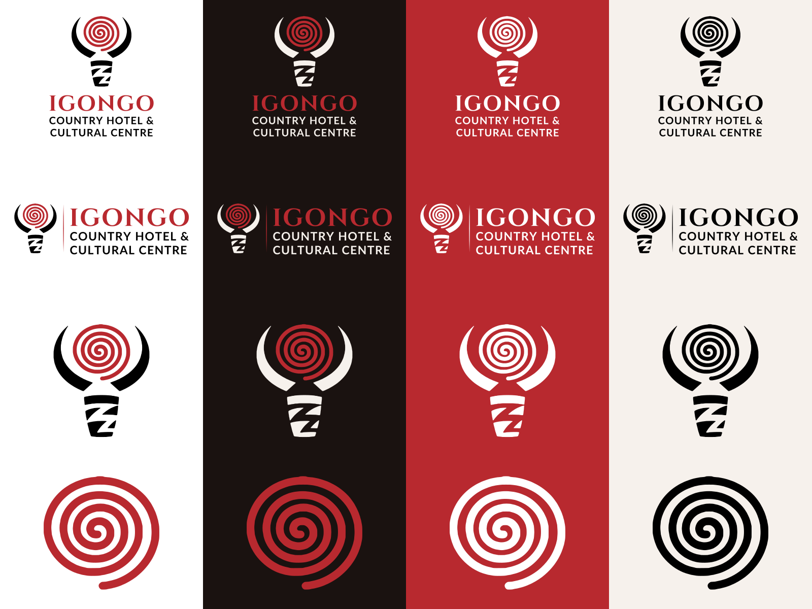
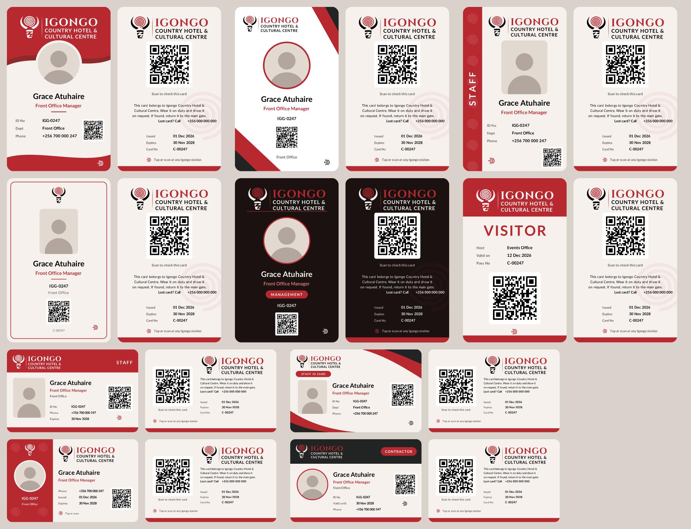

# Igongo brand kit

Every logo, icon, splash screen, animation and print design used by the Igongo app, the web portal and the website. All of it is built from **one master vector** of the hotel's mark and the logo's two fonts, so every asset matches.



[Theme](../../docs/design/theme.md) · [Design tokens](../design-tokens/tokens.json) · [Build checklist](../../docs/BUILD-CHECKLIST.md)

## Rules

1. **Use only these files.** No app, page or print job keeps its own copy of the logo. Link to or copy from here.
2. **Never redraw, stretch, rotate, recolour or add effects** to the logo. Use one of the five colourways below.
3. **Clear space:** keep empty space around the logo of at least the height of the cup. The files already include it.
4. **Minimum sizes:** stacked logo 120 px (25 mm) wide, horizontal logo 160 px (35 mm) wide, mark 24 px (6 mm) tall. Below that, use the mark or the spiral alone.
5. **Backgrounds:** the colour logo on white or cream, the reversed logo on dark or on photos (with a dark overlay), the white logo on Igongo red.
6. **Fonts:** Cinzel only for the IGONGO name and brand titles. Lato for all other text.

## Colours

Sampled from the hotel's original logo files.

| Name | Hex | Where it is used |
| --- | --- | --- |
| Igongo red | `#B8292F` | The spiral, the IGONGO name, main buttons |
| Deep red | `#8F292A` | Pressed states and dark accents |
| Ink | `#000000` | The horns and the cup |
| Charcoal | `#222323` | Subtitle and secondary text |
| Cream | `#F6F1EC` | The reversed logo and the app background |
| Night | `#1A1210` | Dark mode background |

## Colourways

| Colourway | Spiral | Horns and cup | Name | When to use it |
| --- | --- | --- | --- | --- |
| `color` | Red | Black | Red | Full colour, on white or cream backgrounds |
| `reversed` | Red | Cream | Red | On dark backgrounds and photos |
| `black` | Black | Black | Black | One-colour print, receipts, stamps |
| `white` | White | White | White | On Igongo red or any strong colour |
| `red` | Red | Red | Red | One-colour print in red, merchandise, embossing |

## What is in this folder

```
packages/brand/
├── README.md                 This guide
├── source/igongo-mark.svg    The master vector of the mark (spiral, horns and cup as named parts)
├── originals/                The hotel's original logo files, renamed, kept for reference
├── fonts/                    Cinzel and Lato, with their licences
├── logo/                     Every logo layout in every colourway
│   ├── stacked/              Mark above the name and subtitle (main logo)
│   ├── horizontal/           Mark, divider, then name and subtitle (headers, letterheads)
│   ├── mark/                 The emblem alone (app icons, small spaces)
│   ├── spiral/               The spiral alone (spinners, patterns, tiny sizes)
│   ├── wordmark/             Name and subtitle without the mark
│   └── name/                 IGONGO alone
├── app-icon/
│   ├── igongo-app-icon.svg   Master icon, light and dark
│   ├── android/res/          Drop-in Android resources: launcher (legacy, round, adaptive
│   │                         with themed monochrome), notification icon, background colour
│   ├── ios/AppIcon.appiconset/   Drop-in iOS icon set: light, dark and tinted (iOS 18)
│   ├── ios/legacy/           Every older iOS size
│   └── play-store/           512 px Play Store icon
├── splash/                   Android 12+ splash icons, centre logos at 1x/2x/3x, colours, previews
├── web/                      Favicons (.ico, .svg with dark mode, PNG), Apple touch icon,
│                             PWA icons, web manifest, share image, and head-tags.html
├── store/                    Play Store feature graphic
├── animation/                Logo animations (see below)
├── social/                   Profile pictures, covers for every network (with safe-area guides),
│                             post and story templates
├── cards/                    The ID card template library (see below)
├── print/                    Wristbands, QR sticker, business card, name badge, letterhead,
│                             receipt headers, email header and signature, watermark
├── pattern/                  Repeating spiral pattern for backgrounds and packaging
├── preview/                  The overview image above
└── scripts/                  The scripts that build everything
```

### File names

All files are named `igongo-<layout>-<colourway>`, with the pixel width added to PNGs, for example:

- `logo/stacked/igongo-stacked-color.svg`
- `logo/horizontal/png/igongo-horizontal-reversed-1024w.png`

Every logo comes as SVG plus PNG at 256, 512, 1024 and 2048 px wide.

## Animations

Each animation is defined once (in `scripts/motion.py`) and exported in every format, so they move the same way everywhere.

| Animation | Length | What it does | Use it for |
| --- | --- | --- | --- |
| `intro-mark` | 2.2 s, once | The spiral unwinds and grows, the horns slide in, the cup rises | Splash screen and app start |
| `intro-stacked` | 3.4 s, once | The same, then IGONGO rises in letter by letter, then the subtitle | Website intro, first launch |
| `intro-horizontal` | 3.6 s, once | The mark, then the divider grows, then the letters rise one by one | Website header, presentations, video |
| `loader-spiral` | 1.2 s, loops | The spiral turns | The standard loading spinner |
| `loader-mark` | 1.2 s, loops | The whole mark, with the spiral turning | Full-screen loading |
| `pulse` | 1.6 s, loops | The mark breathes gently | Waiting, pull to refresh, payment in progress |

Each one comes in light and dark versions as:

- **Lottie JSON** (`.json`) for the Flutter app, with the `lottie` package. Not made for the two intros with text, so use their GIF, video or animated SVG.
- **Animated SVG** (`.svg`) for the web. It plays in every modern browser with no script.
- **GIF** (`.gif`) for email, WhatsApp and anywhere else.
- **MP4** (`.mp4`) for social media and presentations.

## Using the assets in the Flutter app

```yaml
# pubspec.yaml
flutter_launcher_icons:
  android: true
  ios: true
  image_path: "../../packages/brand/app-icon/ios/AppIcon.appiconset/AppIcon-1024.png"
  adaptive_icon_background: "#F6F1EC"
  adaptive_icon_foreground: "../../packages/brand/app-icon/android/res/mipmap-xxxhdpi/ic_launcher_foreground.png"
  adaptive_icon_monochrome: "../../packages/brand/app-icon/android/res/mipmap-xxxhdpi/ic_launcher_monochrome.png"

flutter_native_splash:
  color: "#F6F1EC"
  color_dark: "#1A1210"
  image: "../../packages/brand/splash/splash-logo-light@3x.png"
  image_dark: "../../packages/brand/splash/splash-logo-dark@3x.png"
  android_12:
    color: "#F6F1EC"
    color_dark: "#1A1210"
    image: "../../packages/brand/splash/android12-splash-icon-light.png"
    image_dark: "../../packages/brand/splash/android12-splash-icon-dark.png"
```

The ready-made Android resources in `app-icon/android/res/` can also be copied straight into `android/app/src/main/res/`, and `app-icon/ios/AppIcon.appiconset/` into `ios/Runner/Assets.xcassets/`.

## Using the assets on the web

Copy the files in `web/` to the site root and paste `web/head-tags.html` into the page `<head>`. The SVG favicon switches to cream horns and cup when the visitor's browser is in dark mode.

## ID card templates

`cards/` holds 10 ready-made card designs for the [NFC & QR Staff Cards](../../docs/modules/16-staff-cards.md) module, each with a front and a back. The super admin assigns a template to each role, department or card type, and can clone and change any of them in the no-code card designer.



| Template | Orientation | Suits |
| --- | --- | --- |
| `portrait-wave` | Portrait | Default for all staff |
| `portrait-diagonal` | Portrait | Guest-facing staff: front office, restaurant, events, sales |
| `portrait-sidebar` | Portrait | Operations: maintenance, housekeeping, security, grounds |
| `portrait-minimal` | Portrait | Museum, cultural centre and spa staff |
| `portrait-executive` | Portrait | Board, CEO, GM and senior managers |
| `portrait-visitor` | Portrait | Visitors, suppliers and day passes (no photo) |
| `landscape-classic` | Landscape | Default landscape card |
| `landscape-curves` | Landscape | Front office, sales and guest relations |
| `landscape-split` | Landscape | Kitchen, restaurant, bars and coffee shops |
| `landscape-banner` | Landscape | Casual workers, contractors and interns |

Each template folder has the front and back as SVG, a PNG preview, and a **print-ready PDF at exact CR80 size** (85.6 × 54 mm), so a card prints at actual size with no editing. `cards/templates.json` lists every template with its print preset (size, 300 dpi, no margins, duplex) and its fields. `cards/card-types.json` holds the card types as data: today's CR80 cards with the **NXP NTAG213** chip, and NTAG 424 DNA ready to switch on later.

### Live fields

Every value that changes per card is marked with a `data-field` attribute, for example `<text data-field="full_name" data-max-width="470">`. The printing module puts the holder's value in, and shrinks text to `data-max-width` when a long name would not fit. The photo (`data-field="photo"`) and QR code (`data-field="qr"`) are groups that it replaces whole. Previews show sample values and a real, scannable QR code.

Fields used: `full_name`, `role`, `department`, `staff_no`, `phone`, `issue_date`, `expiry_date`, `card_no`, `card_label`, `photo`, `qr`, `hotel_phone`, `host`, `valid_on`.

## Print and stationery

Physical items are drawn at exact size and saved as an SVG template, a PNG preview and a print-ready PDF.

| Item | Size | Files |
| --- | --- | --- |
| Event wristbands: guest (red), VIP (dark) and crew (cream) | 250 × 25 mm | `print/wristbands/`, with `wristbands.json` |
| QR sticker for tables, rooms, assets, exhibits and patrol points | 50 × 65 mm | `print/qr-sticker*` |
| Business card, front and back | 90 × 55 mm | `print/business-card-*` |
| Name badge | 75 × 25 mm | `print/name-badge*` |
| Letterhead | A4 | `print/letterhead-a4*` |
| Receipt header, black only | 58 mm (384 px) and 80 mm (576 px) thermal printers | `print/receipt-header-*.png` |
| Email header | 600 × 150 (1200 × 300 file) | `print/email-header@2x.png` |
| Email signature | HTML table with a 2x logo | `print/email-signature.html` |
| Watermark for photos and documents | Light and dark | `print/watermark-*` |

Wristband fields are `band_no`, `event_name`, `event_date` and `qr`. The email signature uses `{{full_name}}`, `{{role}}`, `{{phone}}`, `{{email}}` and `{{logo_url}}`, filled per person; point `logo_url` at the hosted copy of `email-signature-logo@2x.png`.

## Social media kit

| Item | Size |
| --- | --- |
| Profile picture, mark on cream or white mark on red | 1080 (Facebook, Instagram, X, LinkedIn, TikTok, YouTube) |
| WhatsApp Business profile | 640 |
| Google Business logo | 720 |
| Facebook cover | 1640 × 624 |
| X header | 1500 × 500 |
| LinkedIn cover | 1584 × 396 |
| YouTube banner | 2560 × 1440 (logo inside the 1546 × 423 safe area) |
| Google Business cover | 1080 × 608 |
| Post templates | 1080 × 1080 and 1080 × 1350 |
| Story template | 1080 × 1920 (clear of the reply bar) |

Profile pictures keep the mark inside the circle every network crops to. Each cover has a guide image in `social/cover/guides/` that shows its safe area. Post and story templates have live `photo`, `headline` and `subline` fields for the Marketing module's post designer.

## Rebuilding

Every folder except `source/`, `originals/`, `fonts/` and `scripts/` is generated. Never edit those files by hand. Change the master, the fonts or the scripts, then rebuild:

```bash
pip install -r packages/brand/scripts/requirements.txt   # ffmpeg is also needed
python packages/brand/scripts/build_brand.py
```

| Script | What it does |
| --- | --- |
| `scripts/trace_mark.py` | One-time: traces the hotel's original mark into `source/igongo-mark.svg` |
| `scripts/brand_kit.py` | Shared pieces: colours, colourways, the master mark, text outlines and file writing |
| `scripts/lockups.py` | The logo layouts: stacked, horizontal, mark, spiral, wordmark and name |
| `scripts/motion.py` | The animations, defined once, with their SMIL and Lottie exports |
| `scripts/canvas.py` | Shared drawing helpers: rendering, placed logos, live fields, QR codes, photos, NFC symbol |
| `scripts/logos.py` | Logo files, the spiral pattern and the overview image |
| `scripts/app_assets.py` | Android and iOS launcher icons and splash screens |
| `scripts/web_assets.py` | Favicons, web manifest, share image and store graphics |
| `scripts/social.py` | Profile pictures, covers, post and story templates |
| `scripts/stationery.py` | Wristbands, sticker, business card, badge, letterhead, receipts, email, watermark |
| `scripts/cards.py` | The ID card template library, its manifest and card types |
| `scripts/animations.py` | Renders the animations to animated SVG, Lottie, GIF and MP4 |
| `scripts/build_brand.py` | Runs every builder in order |

The scripts pass `ruff check` (config in `scripts/ruff.toml`) with no warnings.

## Fonts and licences

Cinzel (by Natanael Gama) and Lato (by Łukasz Dziedzic) are used under the SIL Open Font License 1.1. The licences are in `fonts/`. Text in every logo file is converted to outlines, so the fonts don't need to be installed to view the logos.
